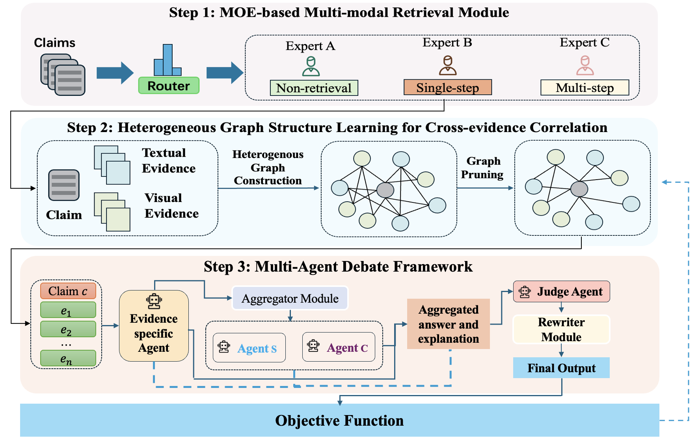

<h1 align="center">AMMFV</h1>
<p align="center"><b>Adaptive Multi-modal Fact Verification via Expert Routing and Multi-Agent Debate</b></p>
<p align="center">
  <a href="#method-overview">Method</a> ·
  <a href="#installation">Installation</a> ·
  <a href="#training">Training</a> ·
  <a href="#evaluation">Evaluation</a> ·
  <a href="docs/usage.md">Documentation</a> ·
  <a href="README.zh-CN.md">中文</a>
</p>

AMMFV combines claim-dependent evidence acquisition, heterogeneous graph reasoning, and multi-agent debate for multimodal fact verification. Given a claim and textual/visual evidence, it produces a veracity judgment and a natural-language explanation. The repository supports experiments on **MOCHEG** and **COSMOS**.

## Method overview

<p align="center">
  
</p>

The framework consists of **adaptive expert routing** for non-retrieval, single-step, and multi-step acquisition; **heterogeneous graph structure learning** to select informative evidence relations; and **multi-agent debate** with evidence agents, standard/counterfactual critics, a Judge, and a Rewriter.

## Installation

Use Python 3.10+ and install a PyTorch build matching your CUDA environment. From the repository root:

```bash
conda create -n ammfv python=3.10 -y
conda activate ammfv
python -m pip install -e .
```

Optional FAISS, TensorBoard, and quantization dependencies are available through `pip install -e ".[index,logging,quantization]"`.

## Data preparation

Download the benchmark releases and keep their annotations and images together:

| Dataset | Source | Native data directory | Configuration |
|---|---|---|---|
| MOCHEG | [Dataset](https://github.com/PLUM-Lab/Mocheg) | `data/raw/mocheg/` | `configs/datasets/mocheg.yaml` |
| COSMOS | [Dataset](https://github.com/shivangi-aneja/COSMOS) | `data/raw/cosmos/` | `configs/datasets/cosmos.yaml` |

Convert the native releases into the shared input format:

```bash
python -m ammfv prepare-dataset --config configs/datasets/mocheg.yaml --root data/raw/mocheg
python -m ammfv prepare-dataset --config configs/datasets/cosmos.yaml --root data/raw/cosmos
```

Each dataset directory contains `train.jsonl`, `validation.jsonl`, `test.jsonl`, `corpus.jsonl`, and a preparation manifest. Conversion preserves the source partitions and resolves image paths. MOCHEG includes three-state labels and reference explanations. COSMOS uses caption-pair contextual consistency, source-caption pairs for train/validation, and original test annotations.

See [data preparation](docs/data_protocol.md) for release layouts, label mappings, and custom datasets.

## Training

The default backbones are:

| Component | Model |
|---|---|
| Shared visual/text features | CLIP ViT-L/14 |
| Text retriever | BGE-large-en-v1.5 |
| Generative agents | LLaVA-v1.6-Mistral-7B |
| S/M/C router | DeBERTa-v3-base |

Download the pretrained assets:

```bash
python scripts/download_models.py --config configs/datasets/mocheg.yaml
```

### Stage 1: Graph structure learning

Build retrieval indexes, cache frozen CLIP features, and train the graph with supervised cross entropy:

```bash
python -m ammfv build-index --config configs/datasets/mocheg.yaml
python -m ammfv cache-features --config configs/datasets/mocheg.yaml
python -m ammfv train-graph --config configs/datasets/mocheg.yaml
```

Training uses AdamW and Gumbel-temperature annealing. Validation macro-F1 selects `checkpoints/mocheg/graph/best.pt`.

### Stage 2: Expert router training

Generate strategy supervision on training claims, then train the claim-only router:

```bash
python -m ammfv router-labels --config configs/datasets/mocheg.yaml --output data/mocheg/router_labels.jsonl
python -m ammfv train-router --config configs/datasets/mocheg.yaml --labels data/mocheg/router_labels.jsonl
```

The supervision rule selects the simplest successful expert: S, otherwise M, otherwise C. The router is saved to `checkpoints/mocheg/router/best/`. For COSMOS, use `cosmos` in the configuration and dataset paths; checkpoints are saved under `checkpoints/cosmos/`.

The complete training sequence is also available through:

```bash
python scripts/run_pipeline.py --config configs/datasets/mocheg.yaml --stages index features graph router_labels router --execute
```

Resume, retrieved-evidence feature caches, multi-GPU training, and model loading are described in the [usage guide](docs/usage.md#training).

## Evaluation

After training, run adaptive retrieval and verification on the test set:

```bash
python -m ammfv infer --config configs/datasets/mocheg.yaml
python -m ammfv evaluate --config configs/datasets/mocheg.yaml --predictions outputs/mocheg/retrieved/full/predictions.jsonl --output outputs/mocheg/retrieved/full/evaluation.json
```

For COSMOS, replace `mocheg` with `cosmos` in the commands. For annotated-evidence evaluation, use the gold configuration:

```bash
python -m ammfv infer --config configs/experiments/mocheg_gold.yaml
python -m ammfv evaluate --config configs/experiments/mocheg_gold.yaml --predictions outputs/mocheg/gold/full/predictions.jsonl --output outputs/mocheg/gold/full/evaluation.json
```

Evaluation reports **accuracy, precision, recall, and F1**, plus **ROUGE-1/2/L and BLEU-1..4** for reference explanations. Run directories contain predictions, metrics, and evidence/agent traces. Custom-claim inference, fixed experts, and sharded evaluation are covered in the [usage guide](docs/usage.md#evaluation-and-inference).

## Reproducing experiments

The experiment matrix covers both datasets, retrieved/gold evidence, and the four component ablations: **no images**, **no adaptive routing**, **no graph**, and **no debate**.

```bash
python scripts/launch.py --spec configs/experiments/matrix.yaml --execute
```

Run the reference-size and evidence-agent sensitivity studies with:

```bash
python scripts/launch.py --spec configs/sweeps/reference_size.yaml --execute
python scripts/launch.py --spec configs/sweeps/agent_count.yaml --execute
```

Configurations are organized under `configs/{datasets,models,hardware,ablations,sweeps}/`. Use `--set key=value` for individual overrides, for example:

```bash
python -m ammfv infer --config configs/datasets/mocheg.yaml --set debate.max_rounds=5 --set output.dir=outputs/mocheg/rounds5
```

Experiment protocols and paired conflict analysis are documented in [reproduction](docs/reproduction.md). Baselines, visualizations, and result aggregation are in the [usage guide](docs/usage.md).

## Project structure

```text
AMMFV/
├── assets/          # Paper framework figure
├── configs/         # Dataset, model, hardware, and experiment settings
├── src/ammfv/       # Retrieval, graph, agents, training, and evaluation
├── scripts/         # Data processing, experiment launchers, and analysis
├── schemas/         # Canonical data and prediction formats
├── docs/            # Detailed usage and method documentation
└── results/         # Manuscript reference tables
```

For implementation details, see the [method-to-code map](docs/paper_to_code.md), [API guide](docs/api.md), and [complete directory tree](PROJECT_TREE.md).
